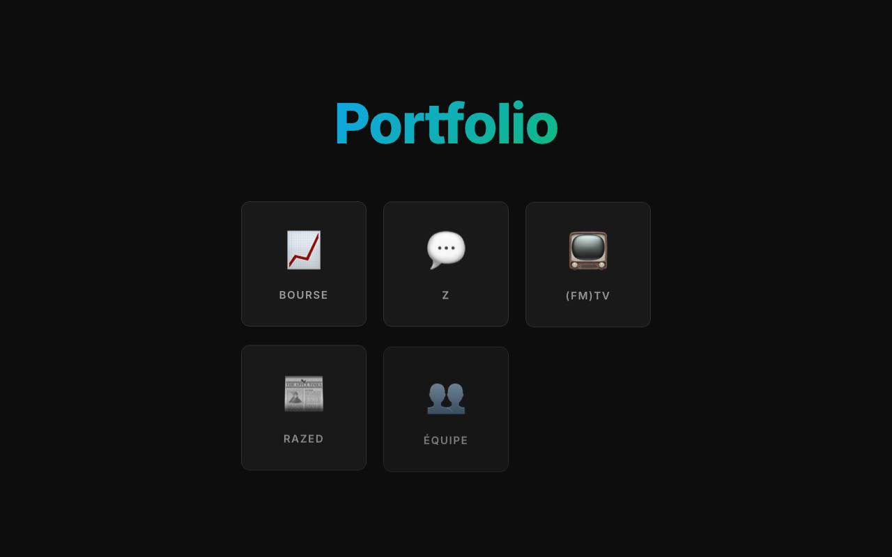
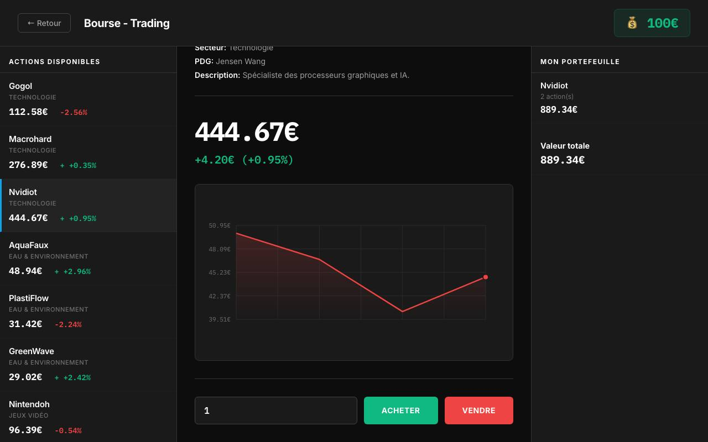
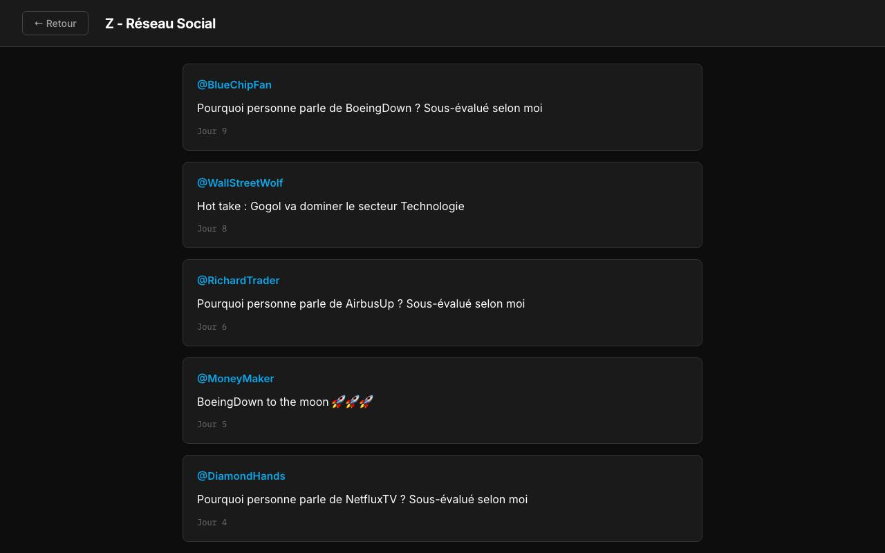
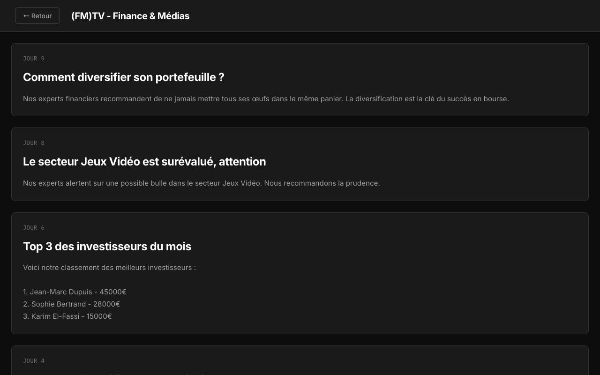

# Portfolio — simulation boursière

Un jeu de bourse dans le navigateur : tu commences avec **1 000 €**. Tu achètes et revends des actions d'entreprises parodiques, en suivant les rumeurs des réseaux sociaux et des journaux, pour grimper au classement des investisseurs.

| Accueil | Bourse |
|---|---|
|  |  |
| **Z, le réseau social** | **(FM)TV, la chaîne d'info** |
|  |  |

## Le jeu

- **24 entreprises parodiques dans 8 secteurs** : Gogol, Macrohard, Nvidiot, Nintendoh, NetfluxTV, TeslaFail, McDodo, BoeingDown…
- **Le temps passe tout seul** : 1 jour = 1 minute. Chaque jour, les cours bougent (de −3 % à +3 %) et des événements peuvent faire monter ou chuter une entreprise.
- **Quatre « applis » sur l'écran d'accueil** :
  - 📈 **Bourse** : liste des actions, graphique des 30 derniers jours, achat et vente, ton portefeuille ;
  - 💬 **Z** : des posts qui lancent des rumeurs ;
  - 📺 **(FM)TV** : des articles d'analyse… et des articles sur toi quand tu dépasses 10 000 € ou entres dans le top 3 ;
  - 📰 **Razed** : les nouvelles qui font bouger les cours.
- **Classement** : tu affrontes 3 investisseurs rivaux, qui démarrent avec 15 000 à 45 000 €.
- **Sauvegarde** : la partie est enregistrée automatiquement dans le navigateur.

## Lancer

```bash
pip install -r requirements.txt
python app.py
```

Ouvre ensuite http://localhost:5000. Sur Mac, si le port 5000 est pris par AirPlay, lance avec `PORT=5001 python app.py`.

## Technique

- **Serveur :** une mini-application Flask qui ne fait qu'afficher la page.
- **Le jeu :** tout tourne en JavaScript, dans le navigateur :
  - `static/js/data.js` : les entreprises, les modèles d'événements et les rivaux ;
  - `static/js/game.js` : le temps, les cours, les médias, le graphique en `<canvas>` et la sauvegarde ;
  - `static/css/style.css` : le style.
- **Crédits :** dans l'appli *Équipe*, Alexandre Roudaut (développement) et Claudia (graphisme).

## À savoir

Sur le graphique, les prix de l'axe vertical sont coupés à gauche pour les actions à 3 chiffres. Par exemple, « 450,95 € » s'affiche « 50,95 € ». La marge du `<canvas>` (50 px) est trop étroite.
